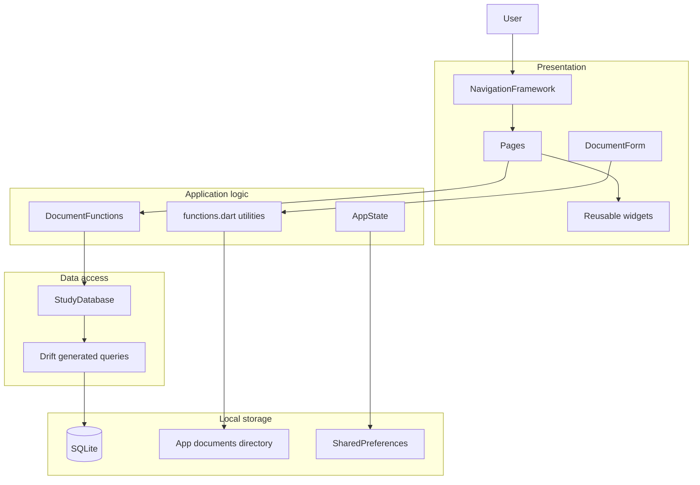
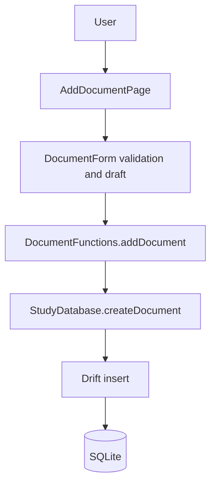
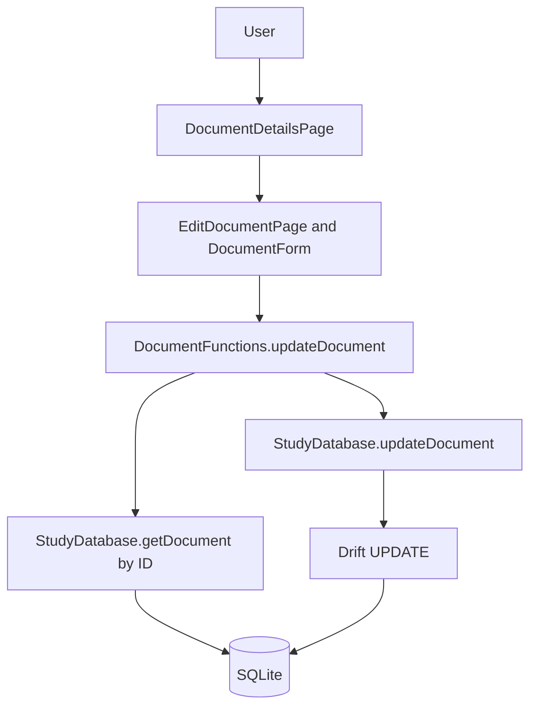
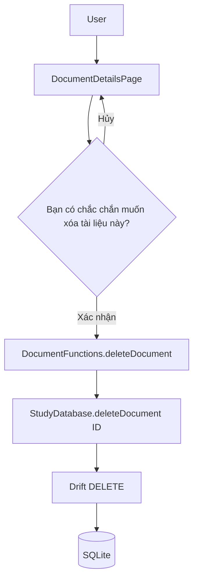
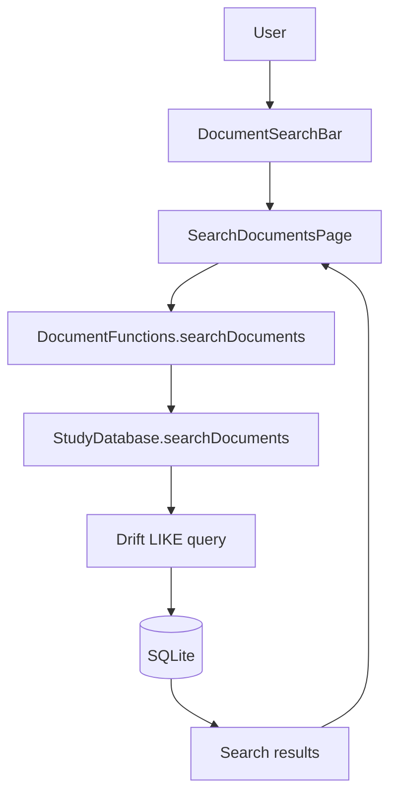
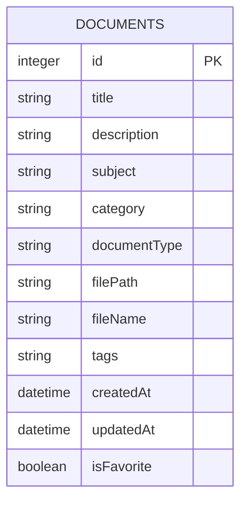

# Architecture and data-flow diagrams

## Tổng quan kiến trúc StudyDocs

`DocumentForm` nhận callback do Page cung cấp; thao tác database chỉ được gọi qua `DocumentFunctions`. `functions.dart` xử lý tiện ích định dạng/tags và sao chép file, không phát sinh SQL.

## DFD thêm tài liệu

## DFD sửa tài liệu

## DFD xóa tài liệu

## DFD tìm kiếm tài liệu

## ERD

