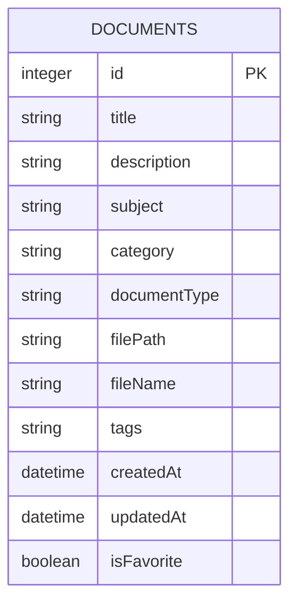
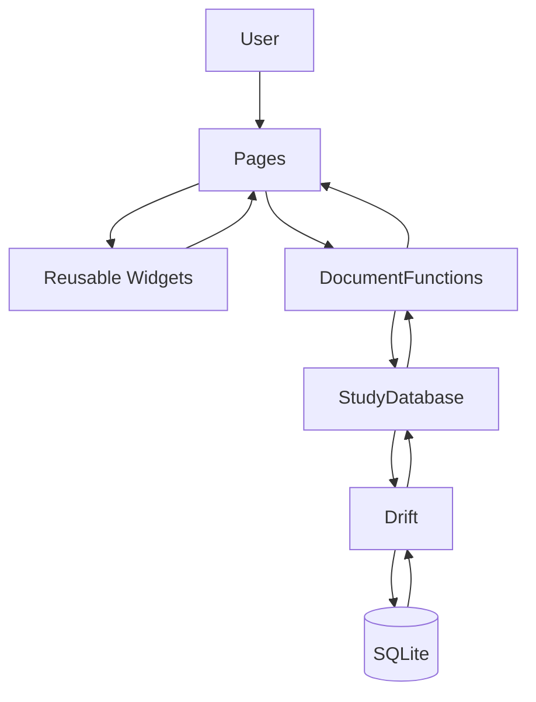
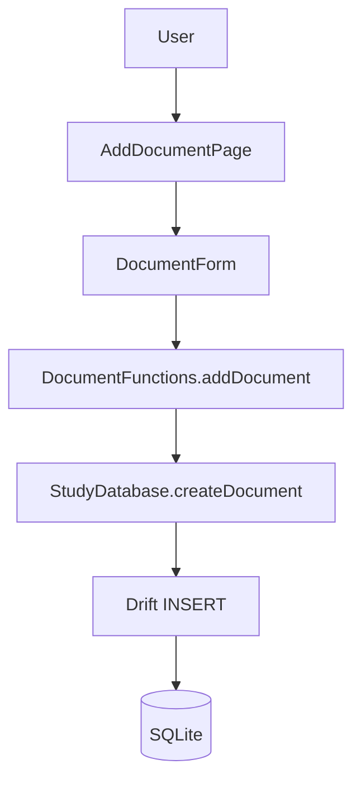
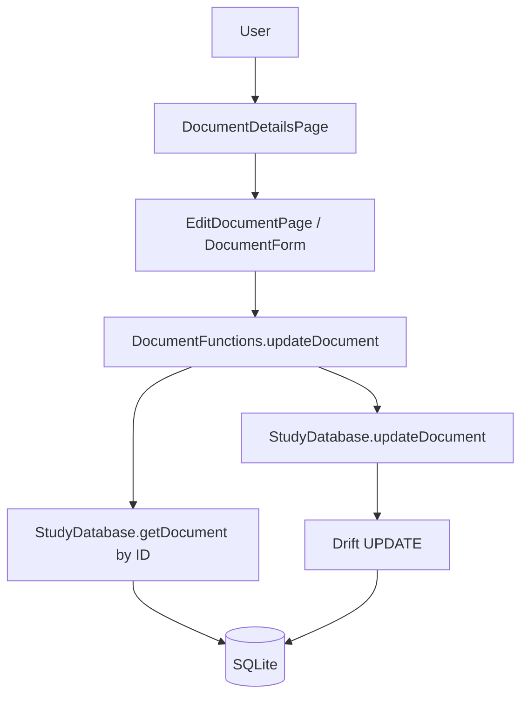
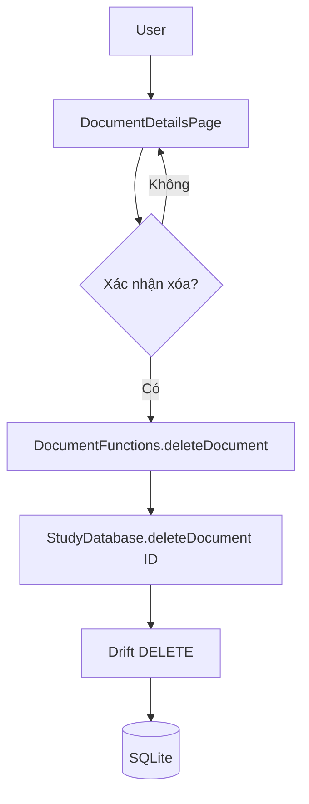
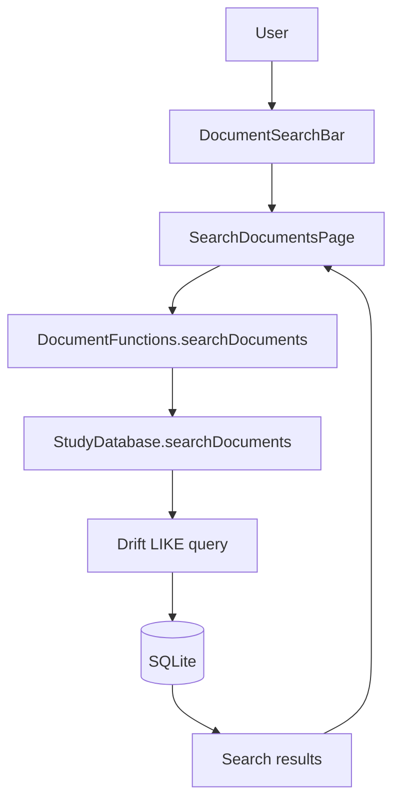

# BÁO CÁO GIẢI TRÌNH

## Xây dựng ứng dụng Quản lý Tài liệu Học tập theo nguyên lý kiến trúc Cashew

**Ứng dụng:** StudyDocs  
**Nền tảng:** Flutter / Dart  
**Lưu trữ:** Drift trên SQLite cục bộ  
**Phạm vi báo cáo:** Phân tích yêu cầu, data flow, tổ chức source theo nhóm Cashew, CRUD/Search và kiểm thử phân tách logic.

---

## 1. Mục tiêu và cách hiểu về kiến trúc Cashew

StudyDocs được tổ chức theo các nguyên lý cấu trúc quan sát từ project Cashew: nhóm màn hình trong `pages/`, thành phần giao diện dùng lại trong `widgets/`, logic ứng dụng trong `struct/`, hàm tiện ích chung trong `functions.dart`, và truy cập dữ liệu trong `database/`.

Đây là việc áp dụng **cách phân nhóm và hướng luồng phụ thuộc** phù hợp với ứng dụng, không phải sao chép source Cashew hoặc gán cho dự án một nhãn kiến trúc khác. Luồng chính được thể hiện bằng code:

```text
Presentation (pages/widgets)
        ↓
Application Logic (struct/documentFunctions.dart)
        ↓
Data Access (database/study_database.dart)
        ↓
Drift
        ↓
SQLite
```

Mục tiêu của việc phân lớp là để giao diện không phải biết câu truy vấn, logic nghiệp vụ không phụ thuộc widget, và database không chứa code trình bày.

---

## 2. Phân tích yêu cầu chức năng

### 2.1 Dữ liệu tài liệu

Schema `Documents` tại `lib/database/tables.dart` lưu:

| Trường | Ý nghĩa |
|---|---|
| `id` | Khóa chính tự tăng |
| `title` | Tên tài liệu, bắt buộc, tối đa 200 ký tự |
| `description` | Mô tả |
| `subject` | Môn học |
| `category` | Danh mục, mặc định “Khác” |
| `documentType` | Loại: Lecture, Exercise, Reference, Textbook, Slide, PDF, Link, Other |
| `filePath` | Đường dẫn tệp cục bộ hoặc URL, có thể rỗng |
| `fileName` | Tên tệp, có thể rỗng |
| `tags` | Các tag đã chuẩn hóa, lưu thành chuỗi |
| `createdAt` | Ngày tạo |
| `updatedAt` | Ngày cập nhật |
| `isFavorite` | Trạng thái yêu thích |

### 2.2 Functional requirements

| ID | Chức năng | Kết quả mong đợi | Source thực hiện |
|---|---|---|---|
| FR01 | Thêm tài liệu | Kiểm tra dữ liệu, thêm một bản ghi SQLite và thông báo kết quả | `pages/addDocumentPage.dart`, `widgets/documentForm.dart`, `struct/documentFunctions.dart` |
| FR02 | Xem danh sách/chi tiết | Đọc tài liệu đã lưu từ SQLite và hiển thị | `pages/documentsListPage.dart`, `pages/documentDetailsPage.dart` |
| FR03 | Sửa tài liệu | Cập nhật đúng bản ghi theo ID, không tạo bản ghi mới | `pages/editDocumentPage.dart`, `DocumentFunctions.updateDocument` |
| FR04 | Xóa tài liệu | Yêu cầu xác nhận trước khi xóa theo ID | `pages/documentDetailsPage.dart`, `DocumentFunctions.deleteDocument` |
| FR05 | Tìm kiếm | Tìm theo tên, môn học, loại, danh mục và tags trong database | `pages/searchDocumentsPage.dart`, `StudyDatabase.searchDocuments` |
| FR06 | Yêu thích | Bật/tắt trạng thái yêu thích của bản ghi | `DocumentFunctions.toggleFavorite`, `StudyDatabase.setFavorite` |
| FR07 | Quản lý nguồn | Chọn và lưu bản sao tệp; lưu URL để mở sau | `lib/functions.dart`, `widgets/documentForm.dart`, `pages/documentDetailsPage.dart` |

### 2.3 Use cases chính

| Người dùng | Thao tác | Luồng |
|---|---|---|
| Sinh viên | Thêm | Mở form → nhập thông tin → application logic kiểm tra → Drift ghi vào SQLite → thông báo |
| Sinh viên | Sửa | Mở chi tiết → mở form sửa → tìm theo ID → cập nhật hàng đó → tải lại chi tiết |
| Sinh viên | Xóa | Mở chi tiết → xác nhận → xóa theo ID → quay về danh sách |
| Sinh viên | Tìm | Nhập từ khóa → application logic chuyển tiếp → SQLite truy vấn → hiển thị kết quả |

---

## 3. Thiết kế và phân lớp source theo Cashew

### 3.1 Cấu trúc thư mục thực tế

```text
lib/
├── main.dart
├── functions.dart
├── database/
│   ├── schema_versions.dart
│   ├── study_database.dart
│   ├── study_database.g.dart
│   └── tables.dart
├── pages/
│   ├── addDocumentPage.dart
│   ├── documentDetailsPage.dart
│   ├── documentsListPage.dart
│   ├── editDocumentPage.dart
│   ├── favoritesPage.dart
│   ├── homePage.dart
│   └── searchDocumentsPage.dart
├── struct/
│   ├── appState.dart
│   ├── databaseGlobal.dart
│   └── documentFunctions.dart
└── widgets/
    ├── documentEntry/
    │   ├── documentEntry.dart
    │   └── documentEntryTag.dart
    ├── documentForm.dart
    ├── emptyState.dart
    ├── globalSnackbar.dart
    ├── navigationFramework.dart
    └── searchBar.dart
```

### 3.2 Trách nhiệm từng khu vực

| Khu vực | Trách nhiệm | Vì sao file nằm ở đây |
|---|---|---|
| `pages/` | Điều phối màn hình, nhận tương tác, gọi logic, hiển thị loading/error/result | `searchDocumentsPage.dart` quản lý trạng thái kết quả tìm kiếm nhưng không tạo SQL |
| `widgets/` | Thành phần UI tái sử dụng và biểu mẫu | `documentForm.dart` quản lý input và xác thực hiển thị, nhận callback `onSave`, không biết database |
| `struct/` | Điều phối nghiệp vụ và đối tượng dùng chung | `documentFunctions.dart` kiểm tra/chuẩn hóa draft và gọi database; không phụ thuộc `BuildContext` |
| `functions.dart` | Hàm tiện ích dùng chung, không đại diện cho một màn hình hay bảng dữ liệu | `parseTags`, `formatDate`, `storePickedFile` |
| `database/` | Schema, query CRUD/search, generated Drift code và version migration | `study_database.dart` định nghĩa thao tác với SQLite; không chứa Flutter UI |
| `main.dart` | Khởi tạo ứng dụng và cung cấp dependency/state | Khởi tạo SharedPreferences, database, app state trước khi dựng navigation |

### 3.3 Vì sao không đặt logic vào Page?

Page chịu trách nhiệm điều phối tương tác và phản hồi trạng thái UI. Nếu validate và SQL cùng nằm trong Page, các màn hình thêm/sửa/tìm sẽ dễ lặp code và khó kiểm thử độc lập. Trong source hiện tại:

- `AddDocumentPage` và `EditDocumentPage` truyền draft vào `DocumentFunctions`.
- `DocumentFunctions` validate dữ liệu, chuẩn hóa tags và điều phối thao tác.
- `StudyDatabase` chứa câu truy vấn Drift.
- `DocumentForm` chỉ gọi callback được truyền vào; không truy cập database.

Tách database thành module riêng giúp schema, CRUD, search và migration có một nơi quản lý; thay đổi cấu trúc SQLite không buộc phải viết lại widget.

### 3.4 Khởi tạo và state dùng chung

`lib/main.dart` thực hiện thứ tự khởi tạo thật:

```text
WidgetsFlutterBinding.ensureInitialized()
 → SharedPreferences.getInstance()
 → DatabaseGlobal.initialize()
 → AppState.initialize()
 → runApp(StudyDocsApp)
 → MultiProvider cung cấp state/database/DocumentFunctions
 → NavigationFramework
```

`DatabaseGlobal` chỉ giữ một instance `StudyDatabase` dùng chung. `AppState` chỉ quản lý tùy chọn dark mode. Việc giới hạn trách nhiệm này tránh biến `struct/` thành nơi chứa global state tùy tiện.

---

## 4. Thiết kế dữ liệu và database

`StudyDatabase` trong `lib/database/study_database.dart` sử dụng Drift để tạo SQLite database. Khóa `id` là integer tự tăng; các trường text, ngày giờ, boolean và nullable được khai báo theo đúng kiểu dữ liệu.

### ERD



Hiện tại tags là chuỗi phân tách dấu phẩy vì ứng dụng có một bảng chính và quy mô nhỏ. Nếu sau này cần thống kê/tag quan hệ hoặc nhiều metadata hơn, có thể tách bảng tags và bảng liên kết bằng migration mới.

`schema_versions.dart` đặt version hiện tại là 2. Migration từ version nhỏ hơn 2 bổ sung `isFavorite`; `study_database.g.dart` là mã Drift sinh ra từ source, không chỉnh sửa thủ công.

SQLite lưu metadata tài liệu. Tệp người dùng chọn được sao chép vào application documents directory; đường dẫn tệp hoặc URL được lưu trong database.

---

## 5. Data Flow Diagram

### 5.1 DFD tổng quát



Widgets form nhận callback do Page cấp nên không tự gọi database. Kết quả trả ngược qua các lớp để Page cập nhật giao diện.

### 5.2 DFD thêm



### 5.3 DFD sửa



### 5.4 DFD xóa



### 5.5 DFD tìm kiếm



---

## 6. Giải trình triển khai chức năng cốt lõi

| Chức năng | Điểm vào Presentation | Application Logic | Data access |
|---|---|---|---|
| Thêm | `pages/addDocumentPage.dart` và `widgets/documentForm.dart` | `DocumentFunctions.addDocument` | `StudyDatabase.createDocument` |
| Sửa | `pages/editDocumentPage.dart` | `DocumentFunctions.updateDocument(id, draft)` | `StudyDatabase.updateDocument` |
| Xóa | `pages/documentDetailsPage.dart` xác nhận trước khi gọi logic | `DocumentFunctions.deleteDocument(id)` | `StudyDatabase.deleteDocument(id)` |
| Tìm | `pages/searchDocumentsPage.dart` | `DocumentFunctions.searchDocuments(query)` | `StudyDatabase.searchDocuments(query)` |

### Thêm

`DocumentFunctions.addDocument` gọi `_validate`, trim các trường văn bản, chuẩn hóa tags qua `parseTags`, gán thời điểm tạo/cập nhật, sau đó gọi `createDocument`. SQLite tự cấp `id`. Trường hợp loại `Link` bắt buộc có URI HTTP hoặc HTTPS hợp lệ.

### Sửa

`DocumentFunctions.updateDocument` tìm bản ghi theo ID trước khi ghi. Nếu không tồn tại, thao tác báo lỗi; nếu tồn tại, `StudyDatabase.updateDocument` replace hàng có ID đó. Logic giữ nguyên `createdAt` và `isFavorite`, cập nhật `updatedAt`; vì vậy không tạo một tài liệu mới khi sửa.

### Xóa

`DocumentDetailsPage` hiển thị xác nhận “Bạn có chắc chắn muốn xóa tài liệu này?” trước khi gọi `deleteDocument`. Database thực hiện delete theo ID. Nếu số bản ghi xóa bằng 0, application logic báo lỗi thay vì coi như thành công.

### Tìm kiếm

Page nhận từ khóa và gọi `DocumentFunctions.searchDocuments`. `StudyDatabase.searchDocuments` xây truy vấn Drift `LIKE` trên title, subject, documentType, category và tags; không nạp danh sách rồi lọc để giả lập tìm kiếm.

---

## 7. Kiểm thử tính đúng đắn và phân tách logic

### 7.1 Bộ kiểm thử

| Test | Điều được chứng minh |
|---|---|
| `test/document_functions_test.dart` | Create/read/update/delete trên SQLite in-memory; update giữ nguyên ID và chỉ một hàng; tìm title/subject/type/tags; validation; favorite và timestamp |
| `test/study_database_migration_test.dart` | Database SQLite version 1 được nâng lên version 2 và có cột `is_favorite` |
| `test/presentation_separation_test.dart` | Form nhận input, validate và gửi `DocumentDraft` qua callback application được truyền vào |
| `test/architecture_separation_test.dart` | Pages/widgets không chứa query/write Drift trực tiếp; logic ứng dụng không phụ thuộc Flutter/`BuildContext`; database không chứa UI; search page gọi application logic |

### 7.2 Kết quả kiểm thử được ghi nhận

- `flutter test test --reporter expanded`: **11 test passed**.
- `flutter analyze`: **No issues found**.

Test source được dùng làm bằng chứng cho các ranh giới kiến trúc, song song với test nghiệp vụ trên SQLite. Các test này kiểm tra code trong project; không thay thế kiểm thử tương tác thủ công trên từng thiết bị Android.

---

## 8. Đánh giá việc áp dụng nguyên lý Cashew

### Điểm đáp ứng

- Source giữ các nhóm `pages/`, `widgets/`, `struct/`, `functions.dart` và `database/`.
- Navigation tập trung tại `widgets/navigationFramework.dart`.
- Business logic không đặt trong Page và không phụ thuộc `BuildContext`.
- CRUD và search truy cập SQLite qua Drift; Page/Widget không viết truy vấn trực tiếp.
- Có database version/migration và test kiến trúc, không chỉ test hiển thị.

### Giới hạn hiện tại

- `DocumentFunctions` phụ thuộc trực tiếp `StudyDatabase`; đây là lựa chọn gọn cho ứng dụng local, nhưng nếu thay hẳn database thì module application logic cũng cần chỉnh hoặc cần bổ sung abstraction.
- Filter môn học/loại hiện lọc danh sách trong application logic sau khi đọc DB; quy mô lớn nên chuyển filter thành query Drift.
- Tags lưu thành chuỗi, chưa tách quan hệ.
- Web chưa cấu hình Drift SQLite WASM; phạm vi lưu native là Android, iOS và Windows.

### Khả năng mở rộng

Khi cần Cloud Sync/Google Drive/Firebase, có thể bổ sung xử lý sync và trạng thái đồng bộ trong vùng `struct/`, đồng thời mở rộng database để lưu sync metadata. Pages tiếp tục gọi application logic, không cần biết chi tiết dịch vụ cloud. Nếu thay SQLite hoàn toàn, phần bị ảnh hưởng chủ yếu là `database/`, `DatabaseGlobal` và các kiểm thử data-access; phần lớn Presentation và validation nghiệp vụ có thể giữ nguyên.

---

## 9. Kết luận

StudyDocs áp dụng nguyên lý tổ chức của Cashew bằng cách giữ rõ ranh giới giữa giao diện, logic ứng dụng, truy cập dữ liệu và lưu trữ. Các thao tác thêm, sửa, xóa và tìm kiếm đi qua đúng luồng Page → `DocumentFunctions` → `StudyDatabase` → Drift → SQLite. Các test CRUD, migration và architecture-separation cung cấp bằng chứng từ source rằng database không bị thay bằng danh sách RAM, Page không tự viết query và logic nghiệp vụ không phụ thuộc widget.

### Tài liệu tham chiếu trong project

- `requirements.md` — yêu cầu chức năng và luồng nghiệp vụ.
- `architecture.md` — phân tích kiến trúc, dependency và khả năng mở rộng.
- `diagrams/architecture_and_flows.md` — sơ đồ Mermaid tổng quát, DFD và ERD.
- `report/final_report.md` — checklist, bảng trace chức năng và kết quả test.
